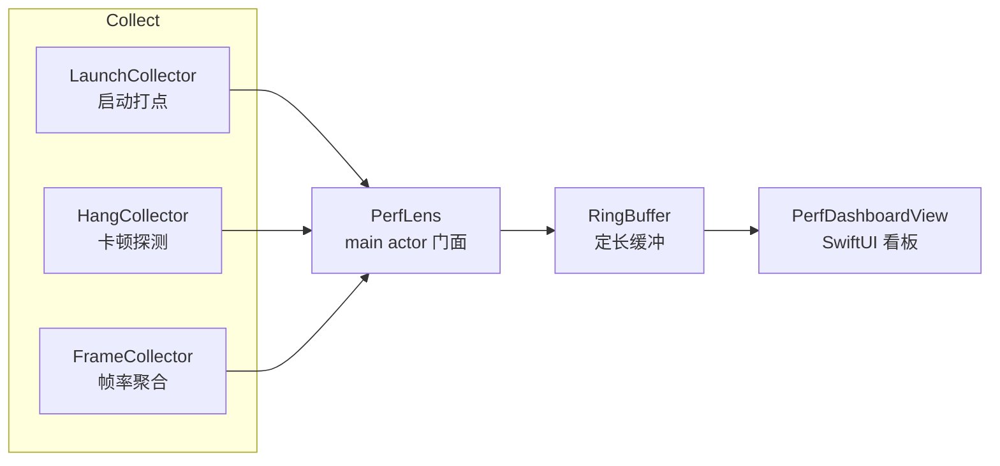

# PerfLens

**中文** | [English](README_EN.md)


轻量级 iOS 性能观测 SDK。零第三方依赖，纯 Swift Package 接入，自带 SwiftUI 看板。

PerfLens 只做三件事：**启动阶段拆分**、**主线程卡顿检测**、**帧率与掉帧统计**。它不捕获崩溃、不监控网络、不内置上报服务——这些交给专门的工具，PerfLens 负责把「用户说有点卡」变成可量化、可比较、可定位的证据。

```swift
PerfLens.start()   // 一行接入，App.init 里调用
```

---

## 目录

- [为什么需要它](#为什么需要它)
- [能力](#能力)
- [指标口径](#指标口径)
- [架构](#架构)
- [快速开始](#快速开始)
- [API 参考](#api-参考)
- [看板](#看板)
- [Demo](#demo)
- [测试与 CI](#测试与-ci)
- [设计取舍](#设计取舍)
- [与替代方案对比](#与替代方案对比)
- [已知边界](#已知边界)
- [Roadmap](#roadmap)
- [目录结构](#目录结构)
- [License](#license)

## 为什么需要它

**1. 真机上说不清的卡。** Instruments 能看清一切，但只能在你手上这台设备复现；用户反馈的「打开慢」「滑动卡」发生在你拿不到的机器、拿不到的机型、拿不到的系统版本上。

**2. 系统数据来得太晚。** MetricKit 提供的是日级聚合，隔天才拿到，只给总时长不给分段，也不带卡顿调用栈。等你看到启动时长涨了 200ms，已经不知道是哪个版本、哪一行代码造成的。

**3. 分段才能归因。** 「启动 972ms」这个数字本身没有行动价值；「pre-main 541ms / 初始化 76ms / 首帧 356ms」才能立刻分成三类不同的问题：二进制体积与 `+load`、业务初始化、首页布局与首屏渲染。

## 能力

| 能力 | 说明 |
| --- | --- |
| 启动阶段拆分 | 拆成 pre-main、初始化、首帧三段，并给出冷/热启动判定 |
| 主线程卡顿检测 | 后台心跳探测，超时挂起主线程抓取原始调用栈 |
| 帧率与掉帧 | `CADisplayLink` 按 1 秒窗口聚合，同时统计 FPS 与掉帧数 |
| 内置看板 | 一套 SwiftUI 视图，接入即可在 App 内查看实时数据 |
| 定长缓冲 | 事件与采样都走环形缓冲，内存占用可预期，不随运行时增长 |
| 零依赖 | 除系统框架外无任何第三方依赖，C target 只负责启动打点与栈遍历 |

## 指标口径

口径固定，数据才能跨版本、跨设备横向比较。

| 指标 | 定义 | 数据来源 |
| --- | --- | --- |
| `preMain` | 内核记录的进程启动时间 → 模块构造函数执行 | `sysctl(KERN_PROC_PID)` + C constructor + `mach_absolute_time` |
| `initialization` | 模块构造 → `didFinishLaunching` | `UIApplication.didFinishLaunchingNotification` |
| `firstFrameDelay` | `didFinishLaunching` → 首帧事务完成 | `CATransaction` completion block |
| `total` | 进程启动 → 首帧完成 | 以上阶段合并 |
| 卡顿时长 | 心跳发出 → 主线程恢复响应 | 后台心跳 + 主线程 ping，回执到达后结算 |
| FPS | 1 秒窗口内 `CADisplayLink` 回调数 / 窗口实际时长 | `CADisplayLink` |
| 掉帧 | `ceil(帧间隔 / 预期帧间隔) - 1`，逐帧累加 | `CADisplayLink.targetTimestamp` |

时间单位全部为秒，`HangEvent` 额外提供 `durationMilliseconds` 便于展示。

几条必须说清的口径约定：

- **`preMain` 是近似值。** 内核不暴露 `main()` 的执行时刻。这里取「内核记录的进程启动时间 → 首个模块构造函数」，误差在毫秒级，但口径恒定，因此版本间可比。
- **卡顿时长在主线程恢复响应后结算。** 拿到的是整段阻塞的实测值，而不是阈值附近的采样点。代价是永远不恢复的卡顿不会产出事件。
- **启动阶段有宽限期。** 默认跳过启动后 1 秒内的卡顿检测：这段时间主线程本来就在跑首帧，由启动指标负责衡量，重复统计只会制造噪音。
- **冷/热启动是启发式判定。** 以「本次进程内是否观测到 `didFinishLaunching`」为准，而不是 `UIApplication.shared.applicationState`——后者在 `App.init` 阶段就已返回 `.active`，用它会把冷启动误判成热启动。若 SDK 在启动完成后才接入，`initialization` 与 `firstFrameDelay` 为 `nil`，只保留总耗时。

## 架构



| 模块 | 职责 | 线程 |
| --- | --- | --- |
| `LaunchCollector` | 只测一次启动，产出 `LaunchMetrics` 后自行释放 | main |
| `HangCollector` | 后台心跳 + 主线程 ping，超时后挂起主线程抓栈 | utility 队列 + main |
| `FrameCollector` | `CADisplayLink` 按窗口聚合，避免逐帧刷新 UI | main |
| `ThreadSampler` | `thread_suspend` + 帧指针遍历，arm64 / x86_64 双架构 | 调用方队列 |
| `RingBuffer` | 定长覆盖式缓冲，`O(1)` 写入 | 由持有方保证 |
| `PerfLens` | `@MainActor` 门面，装配采集器并把结果发布给 UI | main |

设计上采集与展示解耦：采集器只负责写入 `@Published` 属性，看板只负责读。任何时刻 `PerfLens.shared` 里的数据都可以被替换为自定义视图消费，不需要改动采集侧。

开销量级：心跳默认 50ms 一次（只在后台队列做一次时间读取与状态判断），帧率回调每帧一次（只累加时间戳与计数），调用栈采样仅在命中卡顿时发生。仓库内尚未做正式 CPU 基准，这一项属于 Roadmap。

## 快速开始

### 通过 Swift Package Manager 接入

```swift
dependencies: [
    .package(url: "https://github.com/peter123023/PerfLens.git", from: "0.1.0")
]
```

本地依赖：

```swift
.package(path: "../PerfLens")
```

### 接入

接入点决定能否测到完整启动链路——**必须在 `App.init` 或 `didFinishLaunching` 之前调用**：

```swift
import PerfLens

@main
struct MyApp: App {
    init() {
        PerfLens.start()
    }

    var body: some Scene {
        WindowGroup { ContentView() }
    }
}
```

晚于启动阶段接入不会报错，会自动降级为热启动数据（只有总耗时，没有分段）。

### 按需配置

```swift
PerfLens.start(config: .init(
    hangThreshold: 0.08,      // 超过 80ms 记一次卡顿
    hangPollInterval: 0.05,   // 心跳间隔
    hangGracePeriod: 1.0,     // 启动宽限期
    maxHangEvents: 50,        // 内存中保留的卡顿条数
    maxFrameSamples: 120,     // 内存中保留的帧率采样点数
    stackFrameLimit: 64       // 单次栈采样最大帧数
))
```

### 读取数据

```swift
struct DebugPanel: View {
    @ObservedObject private var lens = PerfLens.shared

    var body: some View {
        if let launch = lens.launch {
            Text("启动 \(launch.total ?? 0, specifier: "%.0f") ms")
        }
        Text("卡顿 \(lens.hangs.count) 次")
        Text("最近帧率 \(lens.frames.last?.fps ?? 0, specifier: "%.0f")")
    }
}
```

所有数据模型都遵循 `Codable`，可以直接序列化成 JSON 落盘或上报，不需要额外适配层。

### 停止与重置

```swift
PerfLens.shared.stop()    // 停掉定时器与 CADisplayLink
PerfLens.shared.reset()   // 清空已有数据，不重启采集
```

## API 参考

### `PerfLens`

`@MainActor public final class PerfLens: ObservableObject`

| 成员 | 说明 |
| --- | --- |
| `static let shared` | 全局单例 |
| `@Published var launch: LaunchMetrics?` | 启动数据，采集完成或有值 |
| `@Published var hangs: [HangEvent]` | 卡顿事件，按时间正序 |
| `@Published var frames: [FrameSample]` | 帧率采样，按时间正序 |
| `start(config:)` | 静态与实例两个入口，重复调用幂等 |
| `stop()` | 停止全部采集器 |
| `reset()` | 清空数据 |

### `PerfLensConfig`

| 参数 | 默认值 | 说明 |
| --- | --- | --- |
| `hangThreshold` | `0.08` | 超过该时长记为一次卡顿 |
| `hangPollInterval` | `0.05` | 心跳轮询间隔，越小越灵敏、开销越高 |
| `hangGracePeriod` | `1.0` | 启动后跳过卡顿检测的时长 |
| `maxHangEvents` | `50` | 卡顿事件保留上限 |
| `maxFrameSamples` | `120` | 帧率采样保留上限 |
| `stackFrameLimit` | `64` | 单次栈采样最大帧数 |

### 数据模型

| 类型 | 字段 |
| --- | --- |
| `LaunchMetrics` | `preMain?` `initialization?` `firstFrameDelay?` `total?` `kind` `capturedAt` |
| `HangEvent` | `id` `timestamp` `duration` `stack: [UInt]` `durationMilliseconds` |
| `FrameSample` | `id` `timestamp` `fps` `droppedFrames` |

`LaunchMetrics.Kind` 为 `.cold` / `.warm`。

## 看板

```swift
PerfDashboardView()
```

也可注入自定义实例：

```swift
PerfDashboardView(lens: myLens)
```

三张卡片分别对应三类问题：

- **启动耗时** —— 总耗时 + 冷/热标签 + 三段横向条形。条形长度直接反映占比，一眼能看出这次的变慢发生在哪一段。
- **帧率** —— 当前 FPS、窗口掉帧数、最近 120 个采样点的折线，附 60 FPS 参考线。滑动、转场、列表复用时看曲线形态。
- **主线程卡顿** —— 最近 5 条事件，含时长、栈深度和首个栈地址。栈地址是定位入口，配合 dSYM 即可还原调用链。

## Demo

仓库内置可运行示例，包含卡顿模拟按钮与 200 行长列表：

```bash
cd Demo
xcodegen generate      # Demo 工程由 project.yml 生成
open PerfLensDemo.xcodeproj
```

修改 `Demo/project.yml` 后重新执行 `xcodegen generate` 即可同步工程配置。

## 测试与 CI

```bash
xcodebuild -scheme PerfLens \
  -destination 'platform=iOS Simulator,name=iPhone 17' \
  test
```

当前 12 个测试用例，覆盖：

- 环形缓冲的覆盖顺序、容量边界与读取顺序
- 启动阶段换算，包含热接入时阶段为 `nil` 的分支
- 掉帧计数的阈值边界
- 卡顿检测的命中、静默与启动宽限三种状态

CI（GitHub Actions，`macos-15`）执行两步：`generic/platform=iOS` 构建 + iOS 模拟器全量单测。

## 设计取舍

**为什么用后台心跳 + 主线程 ping，而不是 `CFRunLoopObserver`？**
RunLoop observer 只能观察 RunLoop 的运转状态，一旦主线程被同步调用阻塞，它自己也不会被回调，你只能事后从时间戳差推断。主动 ping 的检测时刻是确定的：超时就能立刻挂起线程抓栈，而且不受 tracking、modal、嵌套 RunLoop 的影响，语义上也更贴近用户的真实感知——「主线程不响应了」。

**为什么卡顿时长要等回执结算？**
如果在检测那一刻就上报，时长永远约等于阈值，无法区分 100ms 的抖动和 5s 的卡死。改成在回执到达时用「ping 发出 → 主线程恢复响应」结算，拿到的是整段阻塞的真实长度。代价是永久卡死不上报，这在 Roadmap 里作为独立场景处理。

**为什么需要启动宽限期？**
冷启动的首帧渲染会稳定占用主线程几百毫秒，它确实是主线程占用，但属于预期内的工作，和用户的「滑动卡顿」是完全不同的两类问题。用 `hangGracePeriod` 把它交给启动指标，避免每次冷启动都产生一条无意义的卡顿记录。

**为什么不用 `applicationState` 判断冷热启动？**
在 iOS 26 上，`App.init` 执行时 `UIApplication.shared.applicationState` 已经是 `.active`，用它判断会把每一次冷启动都判成热启动。改为以「本次进程内是否观测到 `didFinishLaunching`」为准，这是唯一可靠的事实来源。

**为什么 `preMain` 用 `sysctl` 近似？**
真正的 pre-main 耗时无法精确取得，但可以取一个口径恒定的近似：内核记录的进程启动时间 → 首个构造函数执行。绝对值有毫秒级误差，可比较性没有损失——性能数据的第一诉求是「不同版本能否对比」，不是「绝对精确到微秒」。

**为什么自己写 `RingBuffer` 而不是用 `Array`？**
`Array.removeFirst()` 是 `O(n)` 的内存移动，在每秒都在写入的采样路径上会持续产生额外开销；定长环形缓冲是 `O(1)` 写入、内存占用恒定，也更符合「只保留最近 N 条」的语义。

## 与替代方案对比

| | Instruments | MetricKit | Pulse | KSCrash | PerfLens |
| --- | --- | --- | --- | --- | --- |
| 数据粒度 | 单次会话，极细 | 日级聚合 | 以网络日志为主 | 崩溃与异常 | 本次会话，实时 |
| 能否看到卡顿栈 | 能（需本地复现） | 否 | 否 | 否（定位不同） | 能（原始地址） |
| 能否带上线 | 否 | 能 | 能 | 能 | 能 |
| 启动阶段拆分 | 手工分析 | 仅总时长 | 否 | 否 | 三段自动拆分 |
| 接入成本 | 手动操作 | 系统自带 | 中等 | 中等 | 一行 `start()` |

定位是互补而非替代：线上崩溃交给 KSCrash / MetricKit，深度剖析交给 Instruments，PerfLens 补的是「真机、实时、带栈、可比较」这一段。

## 已知边界

- 栈采样基于帧指针遍历（arm64 / x86_64），未做 DWARF 展开；`-fomit-frame-pointer` 编译的二进制栈会不完整。
- 卡顿栈只保留原始地址，符号化需要按 dSYM 的 UUID 匹配后离线处理。
- 永久不恢复的卡顿不会产出事件（等待回执结算的必然结果）。
- 只采集主线程，不覆盖子线程死锁与 GCD 队列拥塞。
- 与 `MetricKit` 未做交叉校验，两套数据的口径不能直接相加。
- 仅声明 iOS 16+；采集实现依赖 UIKit 与 `CADisplayLink`，尚未适配 macOS / tvOS。
- 未做低电量或后台场景的采样降级——本版本没有上报链路，暂不需要。

## Roadmap

- `0.2` — 栈地址符号化：dSYM / UUID 匹配，输出可读调用链
- `0.3` — 数据导出：JSON 落盘与分享面板
- `0.4` — SwiftUI 视图刷新归因：区分布局、绘制与数据计算耗时
- `0.5` — 采样策略：按电量、热状态与前后台自适应调整心跳频率

## 目录结构

```
PerfLens/
├── Package.swift
├── Sources/
│   ├── PerfLensBootstrap/          # C target：启动打点 + 线程栈遍历
│   │   ├── include/PerfLensBootstrap.h
│   │   └── PerfLensBootstrap.c
│   └── PerfLens/
│       ├── PerfLens.swift          # main actor 门面
│       ├── PerfLensConfig.swift    # 配置
│       ├── Metrics.swift           # 数据模型
│       ├── Core/                   # 时钟、环形缓冲、栈采样、指标换算
│       ├── Collectors/             # 启动 / 卡顿 / 帧率
│       └── UI/PerfDashboardView.swift
├── Tests/PerfLensTests/
├── Demo/                           # XcodeGen 驱动的可运行示例
└── .github/workflows/ci.yml
```

## License

MIT
