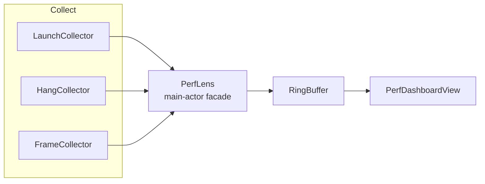

# PerfLens

[中文](README.md) | **English**


A lightweight performance observability SDK for iOS. No third-party dependencies, pure Swift Package integration, with a built-in SwiftUI dashboard.

PerfLens does exactly three things: **launch phase breakdown**, **main-thread hang detection**, and **frame rate / dropped frame stats**. It does not capture crashes, does not monitor networking, and ships no upload pipeline. Those belong to dedicated tools. PerfLens turns "the app feels laggy" into evidence you can measure, compare, and trace to a call site.

```swift
PerfLens.start()   // one line, call it from App.init
```

---

## Table of Contents

- [Why PerfLens](#why-perflens)
- [Features](#features)
- [Metric Definitions](#metric-definitions)
- [Architecture](#architecture)
- [Getting Started](#getting-started)
- [API Reference](#api-reference)
- [Dashboard](#dashboard)
- [Demo](#demo)
- [Tests and CI](#tests-and-ci)
- [Design Decisions](#design-decisions)
- [Comparison](#comparison)
- [Known Limitations](#known-limitations)
- [Roadmap](#roadmap)
- [Project Layout](#project-layout)
- [License](#license)

## Why PerfLens

**1. Real-device jank you cannot reproduce.** Instruments shows you everything, but only on the device in your hand. The "slow launch" or "laggy scrolling" reported by users happens on hardware, OS versions, and builds you never get access to.

**2. System data arrives too late.** MetricKit gives you daily aggregates delivered the next day, reports a single total without a breakdown, and carries no hang stack traces. By the time the launch time regresses by 200 ms, you no longer know which release or which line caused it.

**3. Only a breakdown lets you attribute.** "Launch took 972 ms" is not actionable. "pre-main 541 ms / initialization 76 ms / first frame 356 ms" immediately splits into three completely different problem classes: binary size and `+load`, business initialization, and first-screen layout and rendering.

## Features

| Feature | Description |
| --- | --- |
| Launch breakdown | Splits launch into pre-main, initialization and first frame, plus cold/warm detection |
| Main-thread hang detection | Background heartbeat with timeout-based thread suspension and raw stack capture |
| Frame rate and dropped frames | `CADisplayLink` aggregated into 1-second windows |
| Built-in dashboard | A SwiftUI view that shows live data inside your app |
| Fixed-size buffers | Events and samples use ring buffers, so memory is bounded and predictable |
| Zero dependencies | Only system frameworks; the C target exists solely for bootstrap timestamping and stack walking |

## Metric Definitions

Stable definitions are what make data comparable across releases and devices.

| Metric | Definition | Source |
| --- | --- | --- |
| `preMain` | Kernel process start time → module constructor execution | `sysctl(KERN_PROC_PID)` + C constructor + `mach_absolute_time` |
| `initialization` | Module constructor → `didFinishLaunching` | `UIApplication.didFinishLaunchingNotification` |
| `firstFrameDelay` | `didFinishLaunching` → first frame transaction commit | `CATransaction` completion block |
| `total` | Process start → first frame | The phases above combined |
| Hang duration | Heartbeat sent → main thread responds again | Background heartbeat + main-thread ping, settled on reply |
| FPS | `CADisplayLink` callbacks in a 1s window / actual window duration | `CADisplayLink` |
| Dropped frames | `ceil(frameInterval / expectedInterval) - 1`, summed per frame | `CADisplayLink.targetTimestamp` |

All durations are in seconds; `HangEvent` also exposes `durationMilliseconds` for display.

Conventions that matter:

- **`preMain` is an approximation.** The kernel does not expose when `main()` runs. We measure "kernel process start → first module constructor", which carries millisecond-level error but a constant definition, so it stays comparable across releases.
- **Hang duration is settled when the main thread replies.** You get the measured length of the whole stall rather than a sample point near the threshold. The tradeoff: a hang that never recovers produces no event.
- **Startup has a grace period.** Hang detection is skipped for the first second by default. During that window the main thread is legitimately busy rendering the first frame; the launch metrics already cover it, and counting it twice only creates noise.
- **Cold/warm launch is heuristic.** It is based on whether `didFinishLaunching` was observed inside the current process—not on `UIApplication.shared.applicationState`, which already reports `.active` during `App.init` and would misclassify every cold launch. If the SDK attaches after launch completes, `initialization` and `firstFrameDelay` are `nil` and only the total is reported.

## Architecture



| Module | Responsibility | Thread |
| --- | --- | --- |
| `LaunchCollector` | Measures launch once, emits `LaunchMetrics`, then releases itself | main |
| `HangCollector` | Background heartbeat + main-thread ping; suspends the thread and walks the stack on timeout | utility queue + main |
| `FrameCollector` | Aggregates `CADisplayLink` into windows instead of updating UI per frame | main |
| `ThreadSampler` | `thread_suspend` + frame-pointer walk, arm64 and x86_64 | caller's queue |
| `RingBuffer` | Fixed-capacity overwrite buffer, `O(1)` writes | guaranteed by owner |
| `PerfLens` | `@MainActor` facade that wires collectors and publishes results | main |

Collection and presentation are decoupled: collectors only write `@Published` properties, and the dashboard only reads them. You can replace the dashboard with your own view at any time without touching the collection side.

Cost profile: the heartbeat fires every 50 ms by default (one timestamp read and a state check on a background queue), the display link callback runs per frame (adding timestamps and counters), and stack capture only happens when a hang is detected. No formal CPU benchmark has been run yet; that is on the roadmap.

## Getting Started

### Swift Package Manager

```swift
dependencies: [
    .package(url: "https://github.com/peter123023/PerfLens.git", from: "0.1.0")
]
```

Local dependency:

```swift
.package(path: "../PerfLens")
```

### Integration

The call site determines whether the full launch path is measured—**call it from `App.init` or before `didFinishLaunching`**:

```swift
import PerfLens

@main
struct MyApp: App {
    init() {
        PerfLens.start()
    }

    var body: some Scene {
        WindowGroup { ContentView() }
    }
}
```

Attaching later does not fail; it degrades to warm-launch data (total only, no breakdown).

### Configuration

```swift
PerfLens.start(config: .init(
    hangThreshold: 0.08,      // anything above 80 ms counts as a hang
    hangPollInterval: 0.05,   // heartbeat interval
    hangGracePeriod: 1.0,     // startup grace period
    maxHangEvents: 50,        // retained hang events
    maxFrameSamples: 120,     // retained frame samples
    stackFrameLimit: 64       // max frames per capture
))
```

### Reading data

```swift
struct DebugPanel: View {
    @ObservedObject private var lens = PerfLens.shared

    var body: some View {
        if let launch = lens.launch {
            Text("Launch \(launch.total ?? 0, specifier: "%.0f") ms")
        }
        Text("Hangs: \(lens.hangs.count)")
        Text("Latest FPS: \(lens.frames.last?.fps ?? 0, specifier: "%.0f")")
    }
}
```

Every model conforms to `Codable`, so you can serialize to JSON for local storage or shipping without an adapter layer.

### Stopping and resetting

```swift
PerfLens.shared.stop()    // cancels the timer and the display link
PerfLens.shared.reset()   // clears data without restarting collection
```

## API Reference

### `PerfLens`

`@MainActor public final class PerfLens: ObservableObject`

| Member | Description |
| --- | --- |
| `static let shared` | Global singleton |
| `@Published var launch: LaunchMetrics?` | Launch metrics once available |
| `@Published var hangs: [HangEvent]` | Hang events, oldest first |
| `@Published var frames: [FrameSample]` | Frame samples, oldest first |
| `start(config:)` | Static and instance entry points; idempotent |
| `stop()` | Stops all collectors |
| `reset()` | Clears collected data |

### `PerfLensConfig`

| Parameter | Default | Description |
| --- | --- | --- |
| `hangThreshold` | `0.08` | Blocking above this duration counts as a hang |
| `hangPollInterval` | `0.05` | Heartbeat interval; lower is more sensitive and more expensive |
| `hangGracePeriod` | `1.0` | Window after start during which hang detection is skipped |
| `maxHangEvents` | `50` | Retained hang events |
| `maxFrameSamples` | `120` | Retained frame samples |
| `stackFrameLimit` | `64` | Max frames per capture |

### Models

| Type | Fields |
| --- | --- |
| `LaunchMetrics` | `preMain?` `initialization?` `firstFrameDelay?` `total?` `kind` `capturedAt` |
| `HangEvent` | `id` `timestamp` `duration` `stack: [UInt]` `durationMilliseconds` |
| `FrameSample` | `id` `timestamp` `fps` `droppedFrames` |

`LaunchMetrics.Kind` is `.cold` or `.warm`.

## Dashboard

```swift
PerfDashboardView()
```

Or inject a custom instance:

```swift
PerfDashboardView(lens: myLens)
```

Three cards, each answering a different question:

- **Launch** — total time, cold/warm badge, and a three-segment bar. Segment length is proportional to its share, so the regression is visible at a glance.
- **Frame rate** — current FPS, dropped frames in the window, and a line chart of the last 120 samples against a 60 FPS reference line. Read the shape during scrolling, transitions, and list reuse.
- **Main-thread hangs** — the five most recent events with duration, stack depth, and the first stack address. That address is the entry point into symbolication with the matching dSYM.

## Demo

A runnable example ships with the repo, including hang simulation buttons and a 200-row list:

```bash
cd Demo
xcodegen generate      # the project is generated from project.yml
open PerfLensDemo.xcodeproj
```

Re-run `xcodegen generate` after editing `Demo/project.yml`.

## Tests and CI

```bash
xcodebuild -scheme PerfLens \
  -destination 'platform=iOS Simulator,name=iPhone 17' \
  test
```

12 test cases currently cover:

- Ring buffer overwrite order, capacity boundaries, and read order
- Launch phase math, including the branch where phases are `nil` for late attachment
- Dropped-frame threshold boundaries
- Hang detection: hit, silence, and startup grace

CI (GitHub Actions, `macos-15`) runs a `generic/platform=iOS` build followed by the full unit test suite on an iOS simulator.

## Design Decisions

**Why a background heartbeat + main-thread ping instead of `CFRunLoopObserver`?**
A run loop observer can only watch the loop's own activity. Once the main thread blocks inside a synchronous call, the observer stops firing too, and you can only infer the stall retroactively from timestamp gaps. An active ping gives you a deterministic detection moment: on timeout you can suspend the thread and capture a stack immediately. It is also unaffected by tracking, modal, or nested run loops, and its semantics match what users actually feel—"the main thread stopped responding".

**Why settle hang duration on reply?**
Reporting at detection time would cap every duration near the threshold, making a 100 ms hiccup indistinguishable from a 5 s freeze. Settling on reply uses the full "ping sent → main thread responds" interval, which is the real length of the stall. The tradeoff is that a permanent freeze never emits, which is tracked as a separate roadmap item.

**Why a startup grace period?**
First-frame rendering reliably occupies the main thread for hundreds of milliseconds. That is real main-thread occupancy, but it is expected work and a completely different problem from scroll jank. `hangGracePeriod` hands it to the launch metrics so every cold start doesn't produce a meaningless hang entry.

**Why not use `applicationState` for cold/warm?**
On iOS 26, `UIApplication.shared.applicationState` already returns `.active` while `App.init` runs, so using it would classify every cold launch as warm. Checking whether `didFinishLaunching` was observed in the current process is the only reliable source of truth.

**Why approximate `preMain` with `sysctl`?**
Exact pre-main time is not available, but a constant-definition approximation is: kernel process start → first constructor. The absolute value carries millisecond-level error; comparability loses nothing. The first requirement of performance data is "can I compare releases", not "is it accurate to the microsecond".

**Why a hand-written `RingBuffer` instead of `Array`?**
`Array.removeFirst()` is an `O(n)` shift, and it would run on a write path that receives samples every second. A fixed-size ring buffer gives `O(1)` writes, constant memory, and exactly the "keep the most recent N" semantics.

## Comparison

| | Instruments | MetricKit | Pulse | KSCrash | PerfLens |
| --- | --- | --- | --- | --- | --- |
| Granularity | Single session, very fine | Daily aggregates | Primarily network logs | Crashes and exceptions | Current session, real time |
| Hang stack traces | Yes (requires local repro) | No | No | No (different scope) | Yes (raw addresses) |
| Can ship to production | No | Yes | Yes | Yes | Yes |
| Launch breakdown | Manual analysis | Total only | No | No | Automatic three-way split |
| Integration cost | Manual workflow | Built into the OS | Moderate | Moderate | One `start()` call |

The relationship is complementary rather than competitive: crashes go to KSCrash / MetricKit, deep profiling goes to Instruments, and PerfLens covers the gap of "on-device, real time, stack-bearing, comparable".

## Known Limitations

- Stack capture uses frame-pointer walking (arm64 / x86_64) without DWARF unwinding; binaries built with `-fomit-frame-pointer` yield incomplete stacks.
- Stacks keep raw addresses; symbolication requires offline dSYM UUID matching.
- Permanent freezes never emit an event (an inherent consequence of settle-on-reply).
- Only the main thread is sampled; child-thread deadlocks and GCD queue congestion are out of scope.
- No cross-validation with `MetricKit`; the two datasets cannot be summed.
- iOS 16+ only; collectors depend on UIKit and `CADisplayLink`, with no macOS / tvOS port yet.
- No low-battery or background sampling degradation—this version has no upload pipeline, so it isn't needed yet.

## Roadmap

- `0.2` — Stack symbolication: dSYM / UUID matching with readable call chains
- `0.3` — Data export: JSON persistence and a share sheet
- `0.4` — SwiftUI refresh attribution: separating layout, drawing, and data computation
- `0.5` — Adaptive sampling: heartbeat frequency based on battery, thermal state, and foreground state

## Project Layout

```
PerfLens/
├── Package.swift
├── Sources/
│   ├── PerfLensBootstrap/          # C target: bootstrap timestamp + stack walking
│   │   ├── include/PerfLensBootstrap.h
│   │   └── PerfLensBootstrap.c
│   └── PerfLens/
│       ├── PerfLens.swift          # main-actor facade
│       ├── PerfLensConfig.swift    # configuration
│       ├── Metrics.swift           # data models
│       ├── Core/                   # clock, ring buffer, stack sampler, metric math
│       ├── Collectors/             # launch / hang / frame rate
│       └── UI/PerfDashboardView.swift
├── Tests/PerfLensTests/
├── Demo/                           # runnable example driven by XcodeGen
└── .github/workflows/ci.yml
```

## License

MIT
